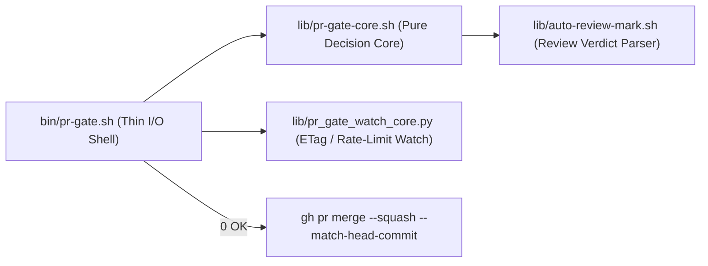

# pr-gate

[](https://github.com/hanzhad/pr-gate/actions/workflows/ci.yml)
[](LICENSE)

Deterministic zero-dependency PR merge gate and NDJSON CI/review watcher — so coding agents never self-approve merges or poll GitHub blindly.

## Why

When autonomous agents open pull requests, `gh pr checks --watch` is not enough: it does not evaluate `CODEOWNERS` or `.github/workflows/` protection, does not track automated review findings on the exact `headRefOid`, and cannot enforce pinned squash-merges (`--match-head-commit`).

`pr-gate` separates **pure policy evaluation** (`lib/pr-gate-core.sh`, `lib/pr_gate_watch_core.py`) from **thin GitHub I/O** (`bin/pr-gate.sh`), producing machine-readable exit codes and `schema: 1` NDJSON events.

## Architecture



## Quick Start

**Requirements:** `bash`, `jq`, `gh` (authenticated), `python3` (standard library only).

```sh
# 1. Single-shot gate evaluation
bin/pr-gate.sh 42 --repo owner/repo
# 0|OK|1|all checks green and review resolved

# 2. Stream CI & review state as NDJSON (fail fast 20s after a CI failure)
bin/pr-gate.sh 42 --repo owner/repo --watch --format ndjson --fail-fast-ci=20

# 3. Evaluate and squash-merge pinned to the verified head SHA
bin/pr-gate.sh 42 --repo owner/repo --merge
```

Example `--watch --format ndjson` output:

```json
{"schema":1,"ts":"2026-11-27T09:15:00Z","repo":"owner/repo","pr":42,"head_sha":"a1b2c3d4e5f6","phase":"ci","event":"heartbeat","severity":"info","code":"WAIT_CI","summary":"waiting for 2 pending check(s)"}
{"schema":1,"ts":"2026-11-27T09:16:12Z","repo":"owner/repo","pr":42,"head_sha":"a1b2c3d4e5f6","phase":"gate","event":"terminal","severity":"terminal","code":"OK","summary":"ready to merge","gate":"0|OK|1|all checks green"}
```

## Exit Codes (`<code>|<STATUS>|<allow_admin>|<reason>`)

| Code | Status | Meaning |
| --- | --- | --- |
| `0` | `OK` | All checks green, review resolved, and no protected paths require manual approval. |
| `1` | `ERROR` | Invalid CLI usage, missing dependency, or unrecoverable GitHub API error. |
| `2` | `WAIT_*` | CI checks or automated review are still pending. |
| `3` | `FIX_*` | CI failed or automated review left unresolved findings on the current head SHA. |
| `4` | `NEEDS_META` | Requires maintainer/orchestrator diff inspection (cross-area PRs, skipped review without `allow_admin`, missing `Executors` ledger block on agent PRs, or missing `Debt-Issue` link on `hotfix` PRs). |
| `5` | `NEEDS_OWNER` | Requires explicit owner approval on `headRefOid` (`CODEOWNERS`, `.github/workflows/`, `no-review` label, or diff size refusal). |
| `6` | `HEAD_DRIFTED` | PR head commit SHA changed while watching; re-evaluate the new head. |
| `7` | `BLOCKED_INFRA` | CI runner scheduling timeout, stalled automated reviewer pickup, or infrastructure outage. |

## Layout

- `bin/pr-gate.sh` — CLI & thin GitHub I/O shell (`--watch`, `--format text|ndjson`, `--fail-fast-ci`, `--wait-all-ci`, `--merge`)
- `bin/auto-review-watch.sh` — compatibility wrapper delegating to `bin/pr-gate.sh --watch`
- `lib/pr-gate-core.sh` — zero-I/O decision core (`evaluate_ci_state`, `evaluate_review_state`, `touches_protected`, `decide_pr_gate`)
- `lib/pr_gate_watch_core.py` — streaming watch state machine & ETag/rate-limit handler
- `lib/auto-review-mark.sh` — structured review verdict parser

## Documentation & Tests

- [Architecture & Protocol](docs/architecture.md) — decision pipeline, `WatchStateMachine`, optional `pr-auto-review` / `docker-ci-gate` integration, and environment variables.
- [Security Policy](SECURITY.md) & [Contributing](CONTRIBUTING.md)

```bash
python3 -m unittest discover -s tests -v
bash tests/test-pr-gate.sh
python3 scripts/scan.py --tree .
python3 scripts/scan.py --history
```

## Local Agentic Engineering Stack

| Repository | Role |
| --- | --- |
| [`agent-dev-slots`](https://github.com/hanzhad/agent-dev-slots) | Isolated, leased dev containers for parallel coding agents |
| [`pin-vault`](https://github.com/hanzhad/pin-vault) | PIN-protected, machine-bound credential vault with `stdin` daemon unlock |
| [`docker-ci-gate`](https://github.com/hanzhad/docker-ci-gate) | Single-use Docker GitHub Actions runners behind a tmpfs credential gate |
| [`pr-auto-review`](https://github.com/hanzhad/pr-auto-review) | Sandboxed continuous PR auto-reviewer across repositories |
| [`pr-gate`](https://github.com/hanzhad/pr-gate) *(this repo)* | Deterministic zero-dependency PR merge gate and NDJSON watcher |
| [`ops-console`](https://github.com/hanzhad/ops-console) | Local operations console for slots, CI gate queue, and GitHub API quota |
